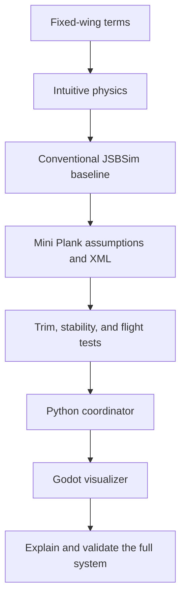

# Mini Plank JSBSim course design

**Created:** 2026-11-02  
**Revised:** 2026-11-02  
**Status:** Accepted syllabus plan, lessons pending  
**Description:** Defines the beginner-first learning progression for simulating
the Flightory Mini Plank with JSBSim, coordinating experiments with Python, and
rendering state in Godot.

## Key decisions

The learner is proficient in Python and new to aviation and flight physics.
Omit Python refreshers. Expand the physics into separate modules, introduce
mathematics through flight examples, and bridge coefficients to simulator
outputs before building the custom model. Require a measurement notebook,
staged model construction, and explicit completion checks. Existing roadmap
and Rust documents are supplementary material, not the course sequence.

1. Start with fixed-wing vocabulary and intuitive physics before XML or code.
2. Use a conventional JSBSim aircraft as a baseline before modeling the
   tailless Mini Plank.
3. Treat the Mini Plank product data as initial assumptions, not validated
   aerodynamic coefficients.
4. Keep JSBSim authoritative for dynamics, Python responsible for orchestration,
   and Godot responsible for visualization.
5. Defer Rust, sensor realism, CFD, and hardware-in-the-loop until the Python
   model and coordinate conventions are understood.

## Reference data

The [Flightory Mini Plank product page](https://flightory.com/product/mini-plank/)
lists a 650 mm wingspan, 370 mm length, 300–400 g all-up weight, 45–55 km/h
optimal speed, PW75 reflex airfoil, a CG reference 35 mm from the leading edge,
and a 2–4° optimal angle-of-attack range. The page also gives a 360 g example
with approximately 28 g/dm² wing loading.

These values are appropriate as course anchors. The page does not by itself
provide a complete JSBSim aerodynamic model, inertia tensor, propulsion map, or
validated control derivatives. The syllabus therefore requires an assumptions
table and one-variable-at-a-time validation.

## Related material

- [Course syllabus](../../docs/syllabus.md)
- [JSBSim + Godot roadmap](../../docs/JSBSim_Godot_Learning_Roadmap.md)
- [JSBSim + Rust flight-controller design](../../docs/JSBSim_Rust_FCU_Design.md)
