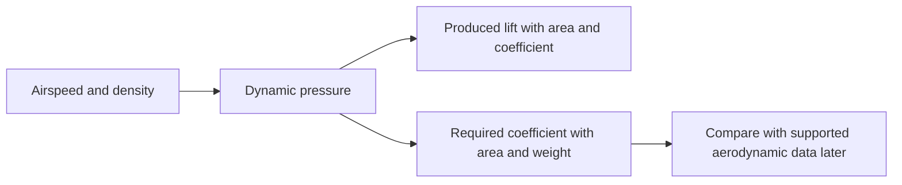

# Module 3 — Aerodynamics and propulsion

**Created:** 2026-11-02

**Status:** Implemented

**Description:** Connect airflow and geometry to force coefficients and propulsion
for a Python-proficient aviation beginner.

## Key decisions

- Implement syllabus Part 3 without claiming Part 2 is available. Link its planned
  prerequisite and recap SI units, weight, and steady force balance.
- Use one lesson with five shared option-based quizzes, a calculation demo,
  and a prediction-first exercise. Reuse Matplotlib and the existing quiz assets.
- Plot dynamic pressure and required lift coefficient for three illustrative
  masses. Keep calculations separate from plotting and check scaling and invalid
  inputs. Save a PNG beside the demo for headless use.
- Use explicitly assumed density and area, not purported PW75 measurements.
  Required coefficients are demands, not evidence that flight is achievable.
- Explain finite-wing drag, stall limits, propeller efficiency, and flight energy
  without introducing an unvalidated aerodynamic polar or propulsion model.

## Related material

- [Syllabus Part 3](../../docs/syllabus.md#part-3-aerodynamics-and-propulsion)
- [Lesson](../../docs/modules/03-aerodynamics/index.md)
- [Experiment](../../examples/03-aerodynamics/lift-envelope/README.md)
- [Course progression](mini-plank-jsbsim-course.md)
