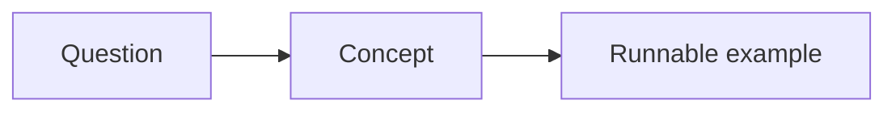

# Module 0: First lesson

This template has been superseded by
[Module 0 — Orientation](../00-orientation/index.md).

## By the end, you will be able to

- Describe **[the first concept]**.
- Run the lesson example.

---

## Intuition

Explain the idea in plain language before introducing details.



---

## Try it

```bash
uv run python examples/00-first-lesson/example.py
```

## Exercise

Change one input in the example and predict what will happen.

## Review

1. What problem does this concept solve?
2. What is the smallest example that demonstrates it?
3. What should you learn next?
