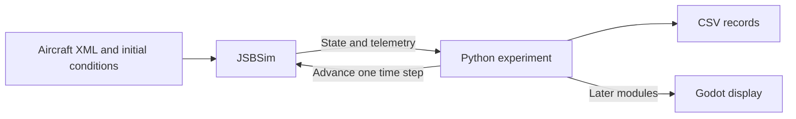

# Module 0 — Orientation and first simulation

By the end, you will be able to:

- Identify what JSBSim, Python, and Godot each contribute.
- Locate a bundled aircraft and run its simulation script.
- Distinguish simulation time from elapsed execution time.
- Read timestamped telemetry with explicit units.

Prerequisite: working Python knowledge and a terminal. Begin with the
[syllabus](../../syllabus.md) for the course scope. No aviation background is required.

---

## Three pieces of the simulator

Think of JSBSim as the engine that calculates aircraft motion. An aircraft XML
model supplies geometry, mass, aerodynamics, propulsion, and control behavior.
Python chooses the experiment, advances time, and reads results. Godot will
eventually draw those results with a mesh, terrain, and camera.

A pretty mesh cannot tell JSBSim the aircraft's mass or aerodynamic behavior.
Similarly, a convincing animation is not evidence that the aircraft physics
match the printed Mini Plank.



<fieldset class="quiz" data-answer="1" data-explanation="JSBSim advances the flight dynamics. Python coordinates execution and Godot displays the result.">
<legend>Which component calculates the aircraft motion?</legend>
<label><input type="radio" name="m0-authority" value="0"> Godot's mesh importer</label>
<label><input type="radio" name="m0-authority" value="1"> JSBSim using the aircraft model</label>
<label><input type="radio" name="m0-authority" value="2"> The CSV writer</label>
<button type="button" class="quiz-check">Check answer</button>
<div class="quiz-result" aria-live="polite"></div>
</fieldset>


---

## Prepare the course environment

Run these commands from the repository root. They install the Python wheel and
its bundled aircraft data; a separate C++ source build is unnecessary for this lesson.
If .venv already exists, skip its creation.

```bash
uv venv .venv
uv pip install --python .venv/bin/python -r requirements-course.txt
.venv/bin/python -c "import jsbsim; print(jsbsim.__version__); print(jsbsim.get_default_root_dir())"
```

The expected JSBSim version is 1.3.3. The second line identifies the package's
data directory. Inside it, aircraft definitions and simulation scripts are
different resources: a script selects an aircraft, initial conditions, and timed
events. Our demo uses the bundled `scripts/c1723.xml` and its `c172x` aircraft.

If the import fails, check that you invoked `.venv/bin/python`. If loading fails,
inspect the printed data directory for that script. Do not silently substitute a
different aircraft: its behavior and controls may differ.

<fieldset class="quiz" data-answer="1" data-explanation="Aircraft XML defines simulation inputs. The visual mesh is a separate asset.">
<legend>What does an aircraft XML model supply?</legend>
<label><input type="radio" name="m0-model" value="0"> Only the visible triangle mesh</label>
<label><input type="radio" name="m0-model" value="1"> Physical and subsystem definitions used by JSBSim</label>
<label><input type="radio" name="m0-model" value="2"> The Godot camera position</label>
<button type="button" class="quiz-check">Check answer</button>
<div class="quiz-result" aria-live="polite"></div>
</fieldset>


---

## Run ten simulated seconds

```bash
.venv/bin/python examples/00-orientation/first-flight/run.py
```

The program creates a new temporary output directory for every run. Open the CSV
path printed at the end. Expect a header followed by ten samples, one per second.
Engine-event notifications from the bundled script are normal.

This script starts a Cessna on the ground, starts its engine, and releases the
brakes. Ten seconds is an observation window, not a promise of level flight.
Its scripted control events are part of the experiment.

Here is the complete runner, included from the tested example:

```python
--8<-- "examples/00-orientation/first-flight/run.py"
```

The fixed step is (1/120) second. Each successful `run()` advances that
simulated duration. Thus 1,200 steps represent ten seconds even if the computer
finishes much faster. We deliberately do not sleep between steps.

<fieldset class="quiz" data-answer="0" data-explanation="The chosen time step defines simulation time. CPU speed determines how quickly this batch finishes.">
<legend>At 120 steps per simulated second, what do 1,200 steps represent?</legend>
<label><input type="radio" name="m0-time" value="0"> Ten simulated seconds regardless of execution speed</label>
<label><input type="radio" name="m0-time" value="1"> Exactly ten seconds on the wall clock</label>
<label><input type="radio" name="m0-time" value="2"> 1,200 rendered video frames</label>
<button type="button" class="quiz-check">Check answer</button>
<div class="quiz-result" aria-live="polite"></div>
</fieldset>


---

## Read the telemetry

| Column | Meaning |
| --- | --- |
| time_s | Time within the simulated run |
| altitude_m | Height above sea level, not height above the runway |
| airspeed_m_s | Speed relative to the surrounding air |
| roll_deg, pitch_deg, heading_deg | Orientation angles, introduced in Module 1 |
| throttle_cmd, elevator_cmd, aileron_cmd | Normalized requests, not surface angles |

The example converts feet to meters and radians to degrees when writing CSV.
Keep units in column names. A number without a unit or reference frame is easy
to misinterpret.

<fieldset class="quiz" data-answer="1" data-explanation="A command is an input. Pitch is a resulting state, influenced by the aircraft and flight conditions.">
<legend>Does an elevator command directly specify a pitch angle?</legend>
<label><input type="radio" name="m0-command" value="0"> Yes, the values are interchangeable</label>
<label><input type="radio" name="m0-command" value="1"> No, it acts through modeled controls and dynamics</label>
<label><input type="radio" name="m0-command" value="2"> Only when the CSV uses degrees</label>
<button type="button" class="quiz-check">Check answer</button>
<div class="quiz-result" aria-live="polite"></div>
</fieldset>


---

## Exercise and completion check

- Run the example twice and retain both CSV files.
- Compare timestamps and telemetry, excluding elapsed wall-clock time and paths.
- Change DURATION_S to 20, predict the sample count, then run again.
- Explain why altitude above sea level need not start at zero on a runway.
- Identify the three command columns separately from measured state columns.

You are ready for Module 1 when you can locate the data, produce the CSV, and
explain the simulation clock. The assertions check finite values and duration;
they do not validate the aircraft against real flight data.

<fieldset class="quiz" data-answer="1" data-explanation="This is an installation and execution check using a bundled Cessna model.">
<legend>What does a successful run establish?</legend>
<label><input type="radio" name="m0-validation" value="0"> The printed Mini Plank is accurately modeled</label>
<label><input type="radio" name="m0-validation" value="1"> The installed baseline loads and advances with finite telemetry</label>
<label><input type="radio" name="m0-validation" value="2"> All aerodynamic assumptions are experimentally verified</label>
<button type="button" class="quiz-check">Check answer</button>
<div class="quiz-result" aria-live="polite"></div>
</fieldset>


---

Next: [Module 1 — Fixed-wing language](../01-flight-language/index.md).

Reference: [JSBSim official repository and Python quick start](https://github.com/JSBSim-Team/jsbsim).

