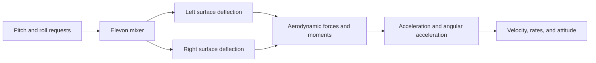

# Module 1 — Fixed-wing language

By the end, you will be able to:

- Label basic wing geometry and aircraft control surfaces.
- Describe body axes, roll, pitch, yaw, and angular rates.
- Distinguish pitch from angle of attack and heading from track.
- Explain how wind separates airspeed from ground speed.
- Describe the purpose of elevon mixing on a tailless aircraft.

Prerequisite: [Module 0](../00-orientation/index.md). This lesson establishes
vocabulary; force calculations and stability analysis follow in the syllabus.

---

## Describe the wing

Imagine looking down on the printed aircraft. The **span** runs from one wingtip
to the other. At a particular position along the span, the **chord** is the
straight distance from the front **leading edge** to the rear **trailing edge**.
A cross-section through the wing is its **airfoil**.

| Term | Meaning |
| --- | --- |
| Planform | Wing outline seen from above |
| Wing area | Reference planform area, with the convention documented |
| Mean aerodynamic chord | A representative chord used for aerodynamic references, not automatically the simple mean of root and tip chords |
| CG, center of gravity | Reference point for the aircraft's weight distribution |
| Control surface | A movable part that changes aerodynamic forces and moments |

The Mini Plank is a tailless plank configuration. Its pitch balance cannot rely
on a conventional separate horizontal tail. A reflex airfoil has an upward
turn near its trailing edge that influences its pitching moment. Geometry, CG,
and control deflections must work together; reflex alone does not establish
stability.

**Hands-on:** Sketch the aircraft from above and from the side. Mark span,
chord, leading/trailing edges, and the approximate CG. Leave unknown dimensions
blank rather than inventing them.

---

## Axes move with the aircraft

Use body axes with origin at the CG: **x forward**, **y toward the right wing**,
and **z downward**. These axes rotate with the aircraft. Local North-East-Down
(NED) axes describe directions relative to the Earth near the aircraft.

| Rotation | Body axis | Positive motion near level flight |
| --- | --- | --- |
| Roll | x | Right wing down |
| Pitch | y | Nose up |
| Yaw | z | Nose right |

Longitudinal motion concerns the forward/vertical plane and pitch. Lateral
motion concerns sideways motion and roll; directional behavior concerns yaw.
These motions can interact.

**Attitude** describes orientation. **Angular rate** describes how fast rotation
occurs: body rates p, q, r correspond to the x, y, z axes. An aircraft can have a
nonzero roll angle while its roll rate is zero. Body rates are not generally
equal to the derivatives of Euler orientation angles.

<fieldset class="quiz" data-answer="1" data-explanation="An angle describes orientation, while a rate describes its change. Holding a bank does not require ongoing roll rotation.">
<legend>The aircraft holds a constant bank angle. Must its roll rate be nonzero?</legend>
<label><input type="radio" name="m1-roll" value="0"> Yes, bank angle and roll rate are the same</label>
<label><input type="radio" name="m1-roll" value="1"> No, it can maintain the angle with zero roll rate</label>
<label><input type="radio" name="m1-roll" value="2"> Only if the wind is calm</label>
<button type="button" class="quiz-check">Check answer</button>
<div class="quiz-result" aria-live="polite"></div>
</fieldset>


---

## Pitch is not angle of attack

**Pitch** describes the nose orientation relative to the local horizon.
**Angle of attack**, alpha, describes the relationship between an aircraft's
chosen longitudinal reference and its air-relative velocity in the symmetry
plane. Airfoil angle of attack instead uses the airfoil chord reference.
Reference lines and wing incidence therefore matter.

A nose-up aircraft may be climbing along nearly the same direction its nose
points, giving a small alpha. It may also be descending with the nose above the
horizon, giving a larger alpha. Pitch alone cannot tell you whether it is near stall.

**Sideslip**, beta, describes sideways airflow relative to the aircraft's
symmetry plane. It is not the same as yaw angle. An aircraft pointing east can
fly without sideslip if its air-relative motion is aligned with its nose.

<fieldset class="quiz" data-answer="1" data-explanation="Angle of attack depends on relative airflow as well as the aircraft reference orientation.">
<legend>Two aircraft have the same pitch. Must their angles of attack match?</legend>
<label><input type="radio" name="m1-alpha" value="0"> Yes, alpha is another name for pitch</label>
<label><input type="radio" name="m1-alpha" value="1"> No, their motion relative to the air may differ</label>
<label><input type="radio" name="m1-alpha" value="2"> Yes, if their masses match</label>
<button type="button" class="quiz-check">Check answer</button>
<div class="quiz-result" aria-live="polite"></div>
</fieldset>


---

## Heading, track, and wind

**Heading** is the horizontal direction the nose points. **Ground track** is the
direction of horizontal movement over the ground. **Airspeed** is speed relative
to the air; **ground speed** is speed relative to the ground. **Climb rate** is
the rate of increasing altitude, not pitch angle.

Imagine walking straight north on a moving walkway carrying you east.
Your direction relative to the walkway stays north, but your path relative to
the building goes northeast. Wind produces a similar velocity addition.

For this example only, assume horizontal flight and zero sideslip, so the
air-relative velocity points along heading. Wind components below indicate
the direction air travels **toward**, unlike weather reports that usually name
where wind comes **from**.

$$
\vec v_{ground} = \vec v_{air} + \vec v_{wind}
$$

At 15 m/s northward airspeed with a 5 m/s eastward wind, the ground velocity has
north component 15 and east component 5. Its magnitude is
The square root of (15² + 5²) is 15.81 m/s, and the track is 18.43° east of north.
With a 5 m/s southward headwind instead, ground speed is 10 m/s.

<fieldset class="quiz" data-answer="2" data-explanation="The southward wind subtracts 5 m/s from the northward air-relative velocity in this horizontal example.">
<legend>You fly north at 15 m/s airspeed into a 5 m/s headwind. What is ground speed?</legend>
<label><input type="radio" name="m1-wind" value="0"> 20 m/s</label>
<label><input type="radio" name="m1-wind" value="1"> 15 m/s</label>
<label><input type="radio" name="m1-wind" value="2"> 10 m/s</label>
<button type="button" class="quiz-check">Check answer</button>
<div class="quiz-result" aria-live="polite"></div>
</fieldset>


Run the experiment from the repository root:

```bash
.venv/bin/python examples/01-flight-language/wind-triangle/run.py
```

```python
--8<-- "examples/01-flight-language/wind-triangle/run.py"
```

Expect calm, headwind, and crosswind results of 15.00, 10.00, and 15.81 m/s.
This is vector arithmetic, not a dynamic aircraft simulation. The built-in
checks include zero ground speed, where ground track is undefined.

<fieldset class="quiz" data-answer="1" data-explanation="Wind changes ground-relative velocity. A nose pointing north does not guarantee a northward path over the ground.">
<legend>A crosswind carries the aircraft east while its nose stays north. What changes?</legend>
<label><input type="radio" name="m1-track" value="0"> Its heading must become east</label>
<label><input type="radio" name="m1-track" value="1"> Its ground track differs from its heading</label>
<label><input type="radio" name="m1-track" value="2"> Its pitch must increase</label>
<button type="button" class="quiz-check">Check answer</button>
<div class="quiz-result" aria-live="polite"></div>
</fieldset>


---

## Controls act through physics

A conventional **elevator** primarily controls pitch, **ailerons** primarily
control roll, and a **rudder** primarily controls yaw. These names describe
intended roles, not a guarantee that their effects are completely independent.

An **elevon** combines elevator and aileron roles. Symmetric motion of two elevons
provides pitch control; differential motion provides roll control. Exact signs,
travel limits, and effectiveness must be checked on the actual model. Two
elevons do not automatically provide independent yaw control.



A **force** changes translational motion. A **moment** is a turning effect about
a reference point. A control command first changes modeled actuator behavior;
the resulting forces and moments influence aircraft motion over time.

<fieldset class="quiz" data-answer="0" data-explanation="Symmetric and differential surface motions combine pitch and roll roles. Actual signs and limits require verification.">
<legend>What is the basic purpose of elevon mixing?</legend>
<label><input type="radio" name="m1-elevons" value="0"> Combine pitch and roll requests into two surface commands</label>
<label><input type="radio" name="m1-elevons" value="1"> Set aircraft attitude directly</label>
<label><input type="radio" name="m1-elevons" value="2"> Guarantee independent pitch, roll, and yaw authority</label>
<button type="button" class="quiz-check">Check answer</button>
<div class="quiz-result" aria-live="polite"></div>
</fieldset>


---

## Exercise and completion check

- Reverse the example crosswind to 5 m/s westward. Predict track and ground
  speed first, then run it. Expected track: 341.57°, speed: 15.81 m/s.
- Explain why a 90° heading means east in this example, not positive pitch.
- Describe an aircraft with positive pitch but negative climb rate.
- Label an elevon command as an input, pitch angle as state, and pitch rate as
  rotational motion.
- Revisit Module 0's CSV and explain every column in everyday language.

You are ready to continue when you can explain the wind results and distinguish
the angle/rate and pitch/alpha pairs without treating them as synonyms.

---

Previous: [Module 0](../00-orientation/index.md).
Next planned topic: [Part 2 — Mathematics, forces, and motion](../../syllabus.md#part-2-mathematics-forces-and-motion).
That lesson is not yet implemented.

Reference: [NASA — Aircraft rotations](https://www1.grc.nasa.gov/beginners-guide-to-aeronautics/aircraft-rotations/).

