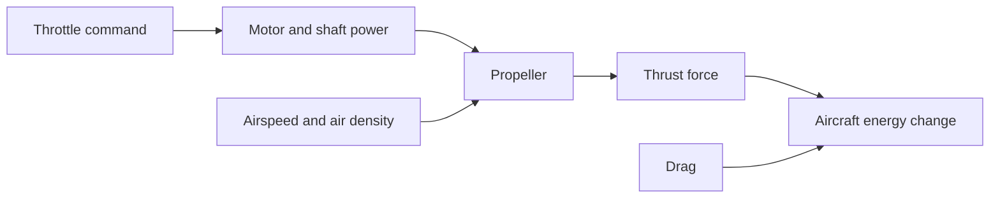

# Module 3 — Aerodynamics and propulsion

By the end, you will be able to:

- Connect relative airflow, density, and speed to dynamic pressure.
- Calculate produced lift and required lift coefficient without confusing them.
- Explain how wing geometry, drag, and stall limit useful flight conditions.
- Distinguish throttle, thrust, power, and efficiency.
- Describe how glide and climb exchange altitude, airspeed, and energy.

Prerequisites: [Module 1 — Flight language](../01-flight-language/index.md) and
[Part 2 — Mathematics, forces, and motion](../../syllabus.md#part-2-mathematics-forces-and-motion).
Part 2 is still planned. For this lesson, use metres, seconds, kilograms, and
newtons consistently: weight is the force $W=mg$, with $g=9.81\ \mathrm{m/s^2}$.
Zero acceleration requires balanced forces. In straight, steady, level flight
with horizontal thrust, lift balances weight and thrust balances drag.

---

## Airflow sets the force scale

Hold a hand in moving air: faster airflow produces a stronger force. The
**relative airflow** is the air's motion relative to the aircraft, opposite its
air-relative velocity. Use true airspeed, not ground speed, in aerodynamic
calculations. **Density**, $\rho$, is air mass per volume; less dense air produces
less force at the same speed and coefficient.

**Dynamic pressure**, $q$, combines density and speed into a useful force-per-area
scale. It is not the atmospheric static pressure or the pressure at every point
on the wing.

$$
q=\tfrac12\rho V^2
$$

With density in kg/m³ and speed in m/s, $q$ has units kg/(m·s²), or N/m² (Pa).
At $\rho=1.225\ \mathrm{kg/m^3}$ and $V=15\ \mathrm{m/s}$, $q=137.8125$ Pa.
At 30 m/s it is 551.25 Pa: doubling speed quadruples dynamic pressure.
This lesson assumes constant density; it does not model an atmosphere.

<fieldset class="quiz" data-answer="1" data-explanation="At fixed density, q scales with V squared. Doubling speed multiplies q by four.">
<legend>At the same density, what happens to dynamic pressure when airspeed doubles?</legend>
<label><input type="radio" name="m3-pressure" value="0"> It doubles</label>
<label><input type="radio" name="m3-pressure" value="1"> It quadruples</label>
<label><input type="radio" name="m3-pressure" value="2"> It stays fixed if mass stays fixed</label>
<button type="button" class="quiz-check">Check answer</button>
<div class="quiz-result" aria-live="polite"></div>
</fieldset>

---

## Coefficients connect airflow to lift and drag

Airflow around the wing creates a distributed load. **Lift** is its component
perpendicular to air-relative motion; **drag** opposes that motion. Lift is not
always vertically upward. [NASA's drag introduction](https://www1.grc.nasa.gov/beginners-guide-to-aeronautics/drag/)
explains these force directions and the additional drag associated with lift.

The dimensionless coefficients $C_L$ and $C_D$ summarize aerodynamic behavior
for a stated configuration and reference area $S$:

$$
L=qSC_L,\qquad D=qSC_D,\qquad \frac{L}{D}=\frac{C_L}{C_D}
$$

The last equality assumes both coefficients use the same area and dynamic
pressure. $qS$ is in newtons, so multiplying by a dimensionless coefficient
still gives force. Coefficients are not universal constants: they depend on
angle of attack, configuration, and flow conditions.

**Angle of attack**, $\alpha$, relates a chosen wing or aircraft reference line
to air-relative motion. Increasing it often increases lift coefficient in the
attached-flow range. Pitch alone does not determine alpha; revisit Module 1's
reference-line distinction.

Separate two questions:

- **Produced lift:** given airflow and $C_L$, calculate $L=qSC_L$.
- **Required lift:** for the assumed level-flight balance, $L_{required}=mg$,
  so $C_{L,required}=mg/(qS)$.

For an illustrative 0.36 kg aircraft with $S=0.13$ m² at 15 m/s,
weight is 3.5316 N and required $C_L$ is about 0.1971. If the actual coefficient
were 0.30, produced lift would instead be about 5.3747 N. Under these force
directions it would not be balanced level flight. Increasing speed at fixed
coefficient increases produced lift; maintaining level flight requires adjusting
the coefficient. A calculation of required CL does not establish trim.

<fieldset class="quiz" data-answer="2" data-explanation="The same mass still needs L = mg. Four times the dynamic pressure requires one quarter of the coefficient at the same area.">
<legend>Speed doubles while mass and area stay fixed. What is required for steady level flight?</legend>
<label><input type="radio" name="m3-lift" value="0"> Four times the required lift and the same CL</label>
<label><input type="radio" name="m3-lift" value="1"> The same required lift and four times the CL</label>
<label><input type="radio" name="m3-lift" value="2"> The same required lift and one quarter of the CL</label>
<button type="button" class="quiz-check">Check answer</button>
<div class="quiz-result" aria-live="polite"></div>
</fieldset>

---

## Geometry and stall set limits

An **airfoil** is a wing cross-section. A finite wing also has tips and a spanwise
lift distribution. Tip flow and downwash change its behavior; section data alone
does not provide a whole-aircraft coefficient table.

**Aspect ratio** compares span $b$ with area: $AR=b^2/S$. It is dimensionless.
**Wing loading** is weight per area, $W/S$, in N/m². A quoted mass per area
(such as kg/m²) must be multiplied by gravity to obtain weight per area.
For assumed $b=0.65$ m, $S=0.13$ m², and mass 0.36 kg, $AR=3.25$ and
$W/S\approx27.17$ N/m². These are illustrative inputs, not measurements.
Higher wing loading needs a larger coefficient at the same density and speed,
or more speed at the same coefficient.

A simple attached-flow approximation illustrates finite-wing drag:

$$
C_D\approx C_{D0}+\frac{C_L^2}{\pi e AR}
$$

Here $C_{D0}$ approximates zero-lift drag and $e$ describes span efficiency.
For otherwise equal conditions, greater aspect ratio reduces this induced-drag
term. This approximation has a limited range; it omits many configuration and
flow effects. [NASA's modern drag equation](https://www1.grc.nasa.gov/beginners-guide-to-aeronautics/modern-drag-equation/)
discusses wing geometry and induced drag. We do not assign a validated polar
to the Mini Plank here.

At sufficiently high alpha, flow separation causes lift to depart from a simple
linear trend: the wing reaches a maximum lift coefficient and stalls. Stall is
an aerodynamic condition, not one universal speed or pitch angle. If a supported
$C_{L,max}$ were known, the level-flight balance would give
$V_{stall}=\sqrt{2mg/(\rho S C_{L,max})}$ for these assumptions. Without that data,
a high required coefficient on a graph is only a demand, not achievable lift.
A straight-line lift curve extrapolated indefinitely cannot model stall.

<fieldset class="quiz" data-answer="0" data-explanation="A required coefficient is a demand. Supported aerodynamic data is needed to decide whether the wing can produce it without stalling.">
<legend>The calculation requires CL = 1.8. What can you conclude?</legend>
<label><input type="radio" name="m3-stall" value="0"> Achievability is unknown without suitable aerodynamic data</label>
<label><input type="radio" name="m3-stall" value="1"> The aircraft automatically produces that coefficient</label>
<label><input type="radio" name="m3-stall" value="2"> Every airfoil stalls at exactly this value</label>
<button type="button" class="quiz-check">Check answer</button>
<div class="quiz-result" aria-live="polite"></div>
</fieldset>

---

## Throttle, thrust, and power

A throttle command influences the motor. The motor supplies shaft power to a
propeller, which accelerates air and produces thrust. Throttle is a command,
thrust is a force in newtons, and power is energy transferred per second in
watts. Half throttle need not mean half thrust: battery voltage, motor speed,
propeller geometry, and forward airspeed all matter.



For thrust aligned with forward motion, useful propulsive power is $P_{useful}=TV$.
Propeller efficiency is $\eta_p=TV/P_{shaft}$ for positive shaft power in forward
powered flight. At 15 m/s, 1 N thrust gives 15 W useful power; with
$\eta_p=0.60$, shaft power is 25 W. Electrical input is larger still if motor
and controller losses are included. At rest, a propeller can produce static
thrust while $TV=0$: do not divide by zero speed to infer thrust from this
power relation. Propulsion maps are needed for an actual model.

<fieldset class="quiz" data-answer="1" data-explanation="Useful power is thrust times speed: 1 N times 15 m/s = 15 W. At 60 percent propeller efficiency, shaft power is 25 W.">
<legend>A propeller gives 1 N at 15 m/s with 60% efficiency. What shaft power is needed?</legend>
<label><input type="radio" name="m3-power" value="0"> 9 W</label>
<label><input type="radio" name="m3-power" value="1"> 25 W</label>
<label><input type="radio" name="m3-power" value="2"> 15 W</label>
<button type="button" class="quiz-check">Check answer</button>
<div class="quiz-result" aria-live="polite"></div>
</fieldset>

---

## Glide, climb, and descent

An unpowered aircraft can keep moving while descending: altitude supplies energy
lost to drag. In a straight steady glide, lift is perpendicular to the descending
path. With descent angle $\gamma$ measured below horizontal,
$L=W\cos\gamma$ and $D=W\sin\gamma$, so $\tan\gamma=D/L$.
Lift is slightly less than weight, not exactly equal to it.
In still air, an L/D of 10 gives 10 m horizontal travel per metre of height lost
in that steady condition. Wind changes ground range.
[NASA's glider force explanation](https://www1.grc.nasa.gov/beginners-guide-to-aeronautics/three-forces-on-a-glider/)
provides the force-balance background.

In still air, with constant mass and thrust along velocity, the energy balance is

$$
\frac{d}{dt}\left(mgh+\tfrac12mV^2\right)=(T-D)V.
$$

Altitude stores potential energy; speed stores kinetic energy. At constant
speed, excess thrust power supports a climb: $mg\dot h=(T-D)V$. An aircraft can
also climb temporarily while slowing down. Pointing the nose up does not create
energy. In a steady unpowered descent, lost potential energy pays for drag.

<fieldset class="quiz" data-answer="2" data-explanation="The glider loses potential energy as it descends. In a steady glide this supplies the energy dissipated by drag while speed stays constant.">
<legend>How can an unpowered glider maintain constant airspeed in still air?</legend>
<label><input type="radio" name="m3-energy" value="0"> Lift creates energy indefinitely</label>
<label><input type="radio" name="m3-energy" value="1"> Drag becomes zero after the motor stops</label>
<label><input type="radio" name="m3-energy" value="2"> It descends, exchanging altitude for energy lost to drag</label>
<button type="button" class="quiz-check">Check answer</button>
<div class="quiz-result" aria-live="polite"></div>
</fieldset>

---

## Run the experiment

Use the course `.venv` from Module 0, including its Matplotlib dependency.
From the repository root:

```bash
.venv/bin/python examples/03-aerodynamics/lift-envelope/check.py
.venv/bin/python examples/03-aerodynamics/lift-envelope/run.py
```

Expect `Lift-demand checks passed` and a reference result of q = 137.81 Pa,
W = 3.5316 N, required CL = 0.1971. Open the generated
`examples/03-aerodynamics/lift-envelope/lift-envelope.png` to compare pressure
against speed and required CL for 0.30, 0.36, and 0.40 kg. The script runs
without a display and overwrites only its previous plot.

```python
--8<-- "examples/03-aerodynamics/lift-envelope/run.py"
```

The plot uses assumed density and area. It computes steady level-flight demand,
not a JSBSim trajectory or an achievable flight envelope. It rejects nonpositive
and nonfinite inputs; at zero speed the required coefficient is undefined.
The checks verify the worked value, scaling with speed, mass, area, and density,
and invalid-input rejection.

---

## Hands-on exercise and completion check

- Before running, sketch q against speed and required CL against speed. Explain
  why all masses share the same pressure curve.
- At 15 m/s, compare 0.30 kg and 0.40 kg. Predict the required-coefficient ratio
  of 4/3, then verify it with the curves or `lift_requirement`.
- Change only `AREA` from 0.13 to 0.26 in the script. Predict unchanged pressure
  and halved required CL, then rerun. Restore the baseline before running checks.
- Calculate produced lift at CL = 0.30 using the baseline inputs. Compare
  5.3747 N with the 3.5316 N requirement and explain why they differ.
- Record which missing data prevents you from declaring a stall speed or motor
  throttle for level flight: supported lift limits, drag, and propulsion data.

Complete this lesson when your predictions match the plot and you can explain
why a required coefficient, a produced force, and a throttle command are different
quantities. Include units and assumptions with every reported value.

---

Previous prerequisite: [Part 2 — Mathematics, forces, and motion (planned)](../../syllabus.md#part-2-mathematics-forces-and-motion).
Next: [Part 4 — Moments, stability, and trim (planned)](../../syllabus.md#part-4-moments-stability-and-trim).
