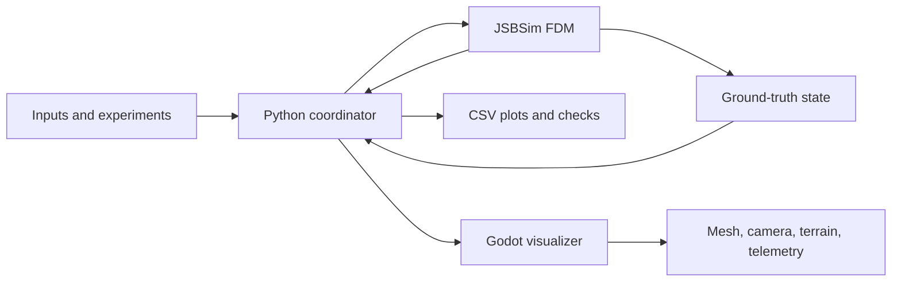

# JSBSim Learn to Fly — Course Syllabus

## Course goal

You already know Python. No previous aircraft, physics, or Godot experience is
required, and there is no Python refresher. The
course starts with the language of flight and ends with a working software-in-
the-loop model of a small tailless aircraft.

By the end, you will be able to:

- explain the basic forces, moments, motion, and control terms used for a
  fixed-wing aircraft;
- build and inspect a JSBSim aircraft model;
- run repeatable simulations from Python and plot the results;
- reason about the Mini Plank's mass, center of gravity, reflex airfoil,
  elevons, trim, stall, and glide behavior;
- stream JSBSim state to Godot for a 3D visual replay; and
- distinguish a physically simulated state from a rendered picture or a
  future flight-controller estimate.

## The capstone aircraft

The reference airframe is the [Flightory Mini Plank](https://flightory.com/product/mini-plank/),
a compact tailless/plank FPV wing. The product page lists a 650 mm wingspan,
370 mm length, 300–400 g all-up weight, a 45–55 km/h optimal speed range, and
a PW75 reflex airfoil. It also describes a 35 mm leading-edge CG reference,
2–4° optimal angle-of-attack range, and a 360 g example with approximately
28 g/dm² wing loading.

These values are the starting point for the simulation, not a promise that the
model will fly exactly like the printed aircraft. We will measure or estimate
unknown values, record assumptions, and validate one behavior at a time.

## System boundary

JSBSim owns the aircraft physics. Python owns experiment setup, stepping,
logging, and communication. Godot only renders the state it receives.

---

## Part 0 — Orientation and tools

Available: [Module 0 lesson and experiment](modules/00-orientation/index.md).

**Outcome:** Run an existing simulation and understand the role
of JSBSim, Python, and Godot.

- Set up JSBSim in the course `.venv` and record the package version.
- Identify the aircraft data directory and the role of the Python interface.
- Run an existing JSBSim aircraft without changing its physics.
- Record time, altitude, airspeed, attitude, and control inputs.

**Checkpoint:** Explain which program is responsible when the aircraft moves on
screen.

---

## Part 1 — Fixed-wing language before equations

Available: [Module 1 lesson and experiment](modules/01-flight-language/index.md).

**Outcome:** Describe an aircraft's orientation and motion using standard terms.

- Airframe, wing, chord, span, mean aerodynamic chord, leading edge, and
  trailing edge.
- Longitudinal, lateral, and directional motion.
- Body axes, Earth/local axes, and why signs and units matter.
- Roll, pitch, yaw, angle of attack, sideslip, heading, climb rate, and
  airspeed.
- Distinguish pitch from angle of attack, airspeed from ground speed, heading
  from ground track, and attitude from angular rate using labeled sketches.
- Control surfaces: elevator, aileron, rudder, and elevon.
- Tailless/plank geometry and why a reflex airfoil helps produce a usable
  pitching-moment balance.

**Checkpoint:** Identify whether a change is a force, a moment, an attitude, a
body rate, or a control command.

---

## Part 2 — Mathematics, forces, and motion

**Outcome:** Predict the direction of the main forces and moments before
running a simulation.

- Units, dimensional checks, rearranging equations, and reading graphs.
- Vectors and trigonometry through resolving a force into components.
- Rates of change through position, velocity, and acceleration plots.
- Mass versus weight, lift, drag, thrust, and free-body diagrams.
- Moment arms, torque, and rotational inertia.
- Newton's laws as applied to translation and rotation.

**Small experiment:** Change only mass, airspeed, or wing area in a simple
calculation and predict how required lift changes.

**Completion check:** Calculate a force balance with consistent units and predict
the acceleration direction before plotting it.

---

## Part 3 — Aerodynamics and propulsion

Available: [Module 3 lesson and experiment](modules/03-aerodynamics/index.md).

**Outcome:** Connect airflow and aircraft geometry to lift, drag, and thrust.

- Relative airflow, air density, dynamic pressure, and angle of attack.
- Airfoil versus whole-wing behavior, aspect ratio, and wing loading.
- Lift and drag coefficients, reference area, and lift-to-drag ratio.
- Stall and the limits of a simplified aerodynamic model.
- Motor, propeller, throttle, thrust, power, and efficiency.
- Glide, climb, descent, and the exchange between altitude and airspeed.

**Experiment:** Plot dynamic pressure against speed and compare required lift
coefficient at different masses in steady level flight.

**Completion check:** Explain the speed-squared relationship and distinguish
required lift from the lift produced at a specified coefficient.

---

## Part 4 — Moments, stability, and trim

**Outcome:** Explain how aircraft balance and control change their motion.

- Pitching, rolling, and yawing moments, CG, and aerodynamic reference points.
- Static stability, dynamic response, damping, and control authority.
- Trim as a steady operating condition, including remaining force and moment
  residuals.
- Reflex-wing pitching balance and sensitivity to CG position.
- Symmetric and differential elevon commands, deflection limits, and signs.
- Banked turns and the relationship between lift direction and flight path.

**Experiment:** Compare illustrative pitching-moment curves and predict the
response to a small disturbance around equilibrium.

**Completion check:** Distinguish a trimmed condition from a stable response and
explain why neither alone establishes that the aircraft model is accurate.

---

## Part 5 — From coefficients to JSBSim forces

**Outcome:** Trace a coefficient table through to a calculated force or moment.

- Reference area, chord, span, and nondimensional coefficients.
- Lookup-table inputs, interpolation, valid ranges, and extrapolation limits.
- Separate airfoil data from whole-aircraft assumptions.
- Track units and axis conventions through a force or moment calculation.

**Completion check:** Calculate one table-based aerodynamic force by hand and
compare it with the corresponding JSBSim output in the next module.

---

## Part 6 — Build a trustworthy JSBSim baseline

**Outcome:** Run deterministic simulations and know what the output means.

- JSBSim's executive, property tree, initial conditions, scripts, and fixed
  time step.
- Aircraft XML structure: metrics, mass balance, aerodynamics, propulsion,
  flight controls, and ground reactions.
- Units and conversions: SI, feet, knots, radians, and degrees.
- Reproducible initial conditions and repeatable logs.
- Assert finite values, check unit conversions and control signs, and repeat
  the same run to compare logs. Separate simulation time from wall-clock time.
- Plot altitude, airspeed, attitude, rates, forces, and control commands.
- Compare a conventional aircraft model before attempting the Mini Plank.

**Deliverable:** A Python runner that advances JSBSim at a fixed step and writes
timestamped CSV telemetry.

---

## Part 7 — Measure and document the Mini Plank

**Outcome:** Assemble the input data needed for a custom aircraft model.

- Measure span, chord, area, surface dimensions, and component locations.
- Record component masses, assembled mass, CG, and inertia estimates.
- Define the coordinate origin and the exact datum for every CG measurement.
- Record each parameter's unit, source, uncertainty, and whether it is measured,
  manufacturer-provided, or assumed.
- Use provisional values if printing is incomplete, then replace them with
  measurements without losing the earlier baseline.

**Completion check:** Produce a parameter notebook with a mass budget, CG
calculation, and an explicit list of missing aerodynamic and propulsion data.

---

## Part 8 — Model the Mini Plank as a learning model

**Outcome:** Turn aircraft information and assumptions into a JSBSim model.

- Choose reference dimensions and wing area from the printed design.
- Estimate mass, center of gravity, inertia, and wing loading.
- Place the CG and understand why a CG error changes pitch stability.
- Start with explicitly labeled educational coefficient tables supplied by the
  lessons. Record their source and valid range, then replace assumptions with
  supported data as it becomes available. Do not label them validated PW75 data.
- Model motor, propeller, throttle, and thrust as a separate subsystem.
- Define left and right elevons and verify their directions.
- Keep a baseline copy and change one parameter at a time.

**Important boundary:** Geometry in an STL or STEP file does not automatically
provide JSBSim's aerodynamic coefficients. The simulation model needs explicit
mass, inertia, force, and moment data.

**Deliverable:** A first Mini Plank XML model with a written assumptions table.

**Build sequence:** Check geometry and mass first, then unpowered flight,
elevon response, and finally propulsion. Preserve a runnable baseline at each
stage. Begin airborne to isolate flight dynamics before adding ground contact.

---

## Part 9 — Trim, stability, and flight-test experiments

**Outcome:** Use simulation evidence to improve the model rather than guessing.

- Find trim conditions at several speeds.
- Test pitch response to elevon input.
- Test roll response to differential elevon input.
- Examine yaw behavior and understand why elevons alone do not guarantee yaw
  control.
- Explore CG movement, mass changes, thrust changes, and control limits.
- Run glide, powered flight, climb, descent, and stall-adjacent experiments.
- Verify repeatable logs, control directions, and small residual accelerations
  at trim, with stated tolerances for each experiment.
- Halve the simulation time step and compare key traces against declared
  tolerances. Investigate sensitivity before accepting a result.
- Separate internal consistency checks from comparison with measurements of
  the physical aircraft. Restrict stall conclusions to supported model ranges.

**Deliverable:** A short flight-test report with plots, changed parameters,
predictions, results, and remaining uncertainty.

---

## Part 10 — Simulation timing, replay, and communication

**Outcome:** Build a clean experiment loop around JSBSim.

- Separate configuration, simulation stepping, controls, logging, and plots.
- Use a fixed simulation clock rather than tying physics to display speed.
- Publish a small state message containing timestamp, position, attitude,
  airspeed, altitude, and control surfaces.
- Add timestamped CSV replay, packet validation, and stale-state handling,
  retaining the checks established in Part 6.
- Learn the difference between JSBSim ground truth and a simulated sensor.

**Deliverable:** A Python simulation service that can run headless and publish
state at a display-friendly rate.

---

## Part 11 — Godot as a visual instrument panel

**Outcome:** Render the simulation without accidentally creating a second
physics engine.

- Install Godot 4 and create a scene with mesh, ground, lighting, and camera.
- Import or create a visual mesh independently of the JSBSim aircraft model.
- Receive Python state over UDP or another simple local transport.
- Convert coordinates and rotations deliberately, testing each sign and axis.
- Start with one camera and telemetry labels. Add trails and replay controls
  after verifying the displayed pose.
- Interpolate display state when packet rate and frame rate differ.

**Deliverable:** Godot displays the aircraft position and attitude produced by
JSBSim, with no Godot rigid-body flight simulation.

**Completion check:** Verify known north/east translations, altitude changes,
and individual roll/pitch/yaw poses. Confirm that changing render frame rate
does not change the recorded JSBSim trajectory.

---

## Part 12 — Capstone: explain the aircraft, not only animate it

**Outcome:** Demonstrate a defensible Mini Plank simulation.

- Run a repeatable mission from a known initial condition.
- Show powered, trimmed, gliding, and control-input cases.
- Display the same run in Python plots and Godot.
- Explain the body frame, local/world frame, units, forces, moments, CG, and
  elevon mixing used by the model.
- Identify which results are supported by source data, which are estimates,
  and which need real flight or wind-tunnel validation.

**Final deliverables:**

- JSBSim aircraft and configuration files;
- Python runner, logger, plots, and replay data;
- Godot visualizer;
- assumptions and coordinate-convention document; and
- a short validation report with known limitations.

---

## Suggested learning order

1. Complete orientation, vocabulary, and physics in Parts 0–4.
2. Connect coefficients to a conventional JSBSim model in Parts 5–6.
3. Measure and progressively model the Mini Plank in Parts 7–8.
4. Evaluate the model in Part 9 before adding communication and Godot in
   Parts 10–11.
5. Complete the capstone in Part 12 with tested units, frames, and limitations.

This syllabus is the course sequence. The existing Godot roadmap and Rust design
are supplementary references, not prerequisites. The parts above describe
planned lessons, not a claim that all lessons and examples already exist.

---

## Lesson format and assessment

- Begin each lesson with “By the end, you will be able to”.
- Explain intuition before equations, then show a worked example.
- Include one runnable experiment, a hands-on exercise, and a measurable
  completion check. Use the course `.venv` for Python examples.
- Include 3–5 option-based checkpoint quizzes per lesson, especially after
  physics and mathematics, using the shared `.quiz` feedback pattern.
- Link prerequisites and the next lesson. Give each runnable demo a README
  with exact commands, expected results, and limitations.

The discussion prompts in this syllabus guide lesson development; they do not
replace the option-based quizzes in the completed lessons.

---

## What is intentionally postponed

- Rust flight-controller development: add it after the Python loop and model
  are understood.
- High-fidelity CFD or system identification: these require data not supplied
  by the basic course.
- Real-aircraft autopilot tuning: simulation success is not flight safety.
- Full terrain, sensor noise, GPS, and hardware-in-the-loop: useful extensions,
  but not prerequisites for understanding JSBSim.
